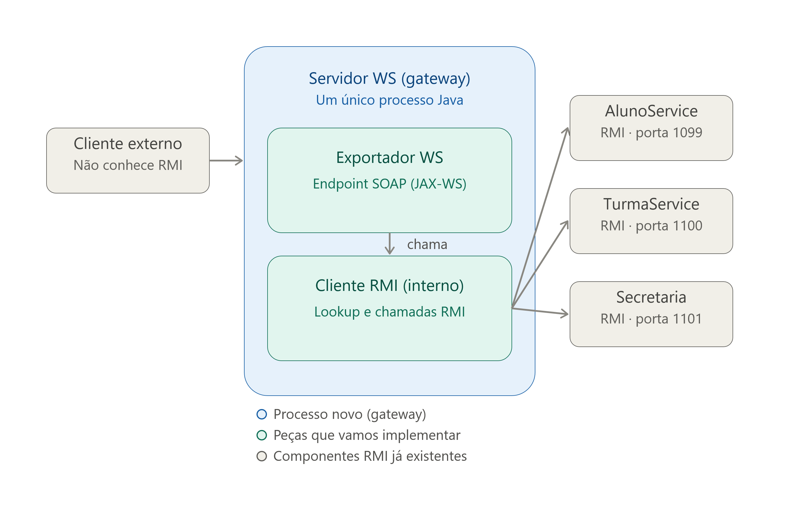

# Trabalho SDI

Reimplementar o sistema acadêmico do UFRN, o SIGAA.

Não liga para os dados. Usa um CSV

Ele quer que faça, inicialmente a parte de acoplamento forte da rede, ou seja, a parte síncrona. Onde os roteadores e switches são da UFRN(?). 

Fazer um server RMI quebrado em tres partes: aluno, turma e secretaria

Cada parte terá seu próprio serviço, os três rodam independente. Depois vamos fazer uma interface de cliente.

## Etapa 2:

### O que temos até agora?

- Temos três servidores (Aluno, Secretaria e Turma)
- Client — Se conecta com os servidores

### O que devemos fazer agora?

- Criar um WS Server — Dividido em **Cliente RMI** e **Exportador WS**
- A ideia é clientes externos acessem os serviços através do WS Server, isso possibilita que implementações diferentes conversem entre si.
- Repo: [https://github.com/mauriciopillon/sdi0001/tree/master/05-WSJava-console](https://github.com/mauriciopillon/sdi0001/tree/master/05-WSJava-console)
- Tem Publisher (que publica as interfaces). Aparentemente o publisher é o Exportador WS.
- Cortar o cliente atual ao meio. Metade dele vai virar um exportador e metade o cliente RMI original.
- Exportador usando SOAP/WSDL?

A avaliação vai ser feita da seguinte forma: cada aluno levanta uma parte do trabalho e um levanta a interface, e tudo tem que rodar. Ele falou que não vai funcionar de primeira, mas de segunda tem que rodar.